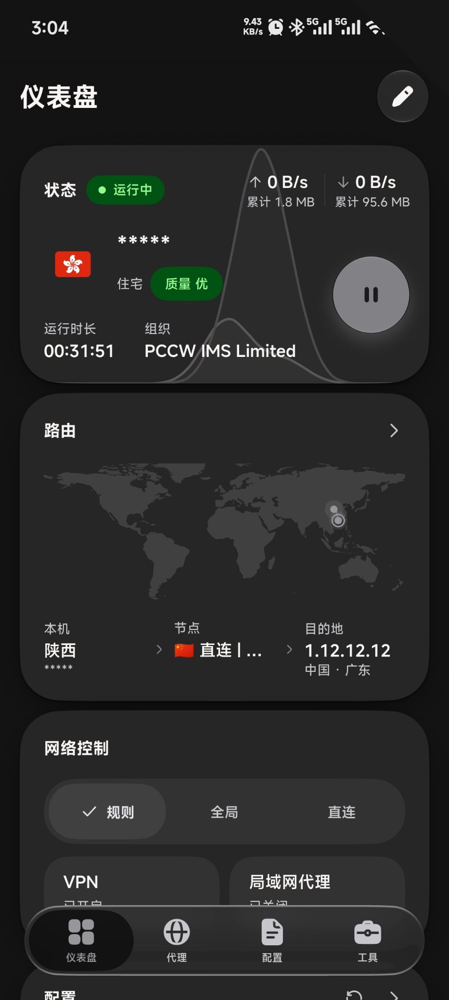

> **Fork notice** — this is [aqiyoung](https://github.com/aqiyoung)'s fork of FlClash, released here as **Skyward** (Skyward). Builds are published in [this repository's releases](../../releases/latest); see [FORK.md](FORK.md) for the version scheme, the signing change and the full list of patches. The upstream project is [chen08209/FlClash](https://github.com/chen08209/FlClash). This repository ships the client only: no proxy servers, subscriptions or accounts are bundled, and no paid service is offered.

<div align="center">


# Skyward

A multi-platform proxy client based on ClashMeta. Simple to use, open source and ad-free.

**English** · [简体中文](README_zh_CN.md)

[](https://github.com/aqiyoung/Skyward/releases/latest)
[](https://github.com/aqiyoung/Skyward/releases)
[](LICENSE)
[](https://t.me/sanyeinfo)

[Releases](https://github.com/aqiyoung/Skyward/releases/latest) · [Download](#download) · [Changelog](CHANGELOG.md) · [Build from source](#build-from-source)

</div>

<p align="center">
  <picture>
    <source media="(prefers-color-scheme: dark)" srcset="snapshots/preview-dark.png">
    
  </picture>
</p>

## Features

- **One app for Android, Windows, macOS and Linux**, with x64 and ARM64 builds on the desktop.
- **Redesigned dashboard**: only the functions you actually use, with live traffic waveform, per-profile
  stats and one-tap details. No clutter.
- **TUN GSO acceleration**: Generic Segmentation Offload lifts single-connection upload throughput up to
  4x on real devices. Toggleable in settings, on by default.
- **mihomo (Clash.Meta) core** with rule routing, proxy groups, latency tests, system proxy and TUN mode,
  defaulting to the high-performance mipstack.
- **Security hardened**: APK downloads verified by SHA-256, no cloud backup of secrets, QuickAction
  caller verification, pinned build dependencies and reproducible release tags.
- **Smart updates**: cross-channel update detection (stable / beta / preview) with background download
  and system installer on Android.
- **Profiles** from a subscription link or a file, with a built-in editor, override scripts, and custom rules,
  proxies and proxy groups.
- **Live views** of connections, requests, DNS queries and logs.
- **Material You design with Apple-style interaction**: dynamic color, light and dark themes, continuous corners,
  sheets that snap between heights, and layouts that adapt from phones to desktops.
- **Backup and restore** through WebDAV or a local file.
- **Platform touches**: a Quick Settings tile, per-app proxy and Android TV support on Android; a tray menu and
  global hotkeys on the desktop.
- **Open source and ad-free**, licensed under GPL-3.0.

## Download

Get the latest build from [this repository's Releases](https://github.com/aqiyoung/Skyward/releases/latest).

| Platform | Packages | Notes |
| --- | --- | --- |
| Android | APK for `arm64-v8a`, `armeabi-v7a` and `x86_64` | Most phones use `arm64-v8a`. |
| Windows 10 and later | Installer (`.exe`) or portable `.zip`, for x64 and ARM64 | Pick ARM64 on Snapdragon and other ARM laptops. |
| macOS 12 and later | DMG for Apple Silicon and Intel | |
| Linux | `.deb`, `.rpm` and AppImage, for x64 and ARM64 | See the tray note below. |

<p>
  <a href="https://github.com/aqiyoung/Skyward/releases/latest"></a>
</p>

These builds are compiled from this repository and signed with its own certificate. Builds from the upstream
project (its website, F-Droid repository or Homebrew tap) carry a different signature, so switching between the
two means uninstalling once — see [FORK.md](https://github.com/aqiyoung/Skyward/blob/main/FORK.md).

**Linux tray icon**

The `.deb` package installs its own dependencies. With the AppImage or the `.rpm`, install the AyatanaAppIndicator
library so the tray icon can show:

```bash
sudo apt-get install libayatana-appindicator3-1   # Debian and Ubuntu
sudo dnf install libayatana-appindicator-gtk3     # Fedora
```

**Unattended desktop**

FlClash starts the core only after the disclaimer is accepted. Where nobody can click it, such as a container, set
`FLCLASH_ACCEPT_DISCLAIMER=1` in the app's environment to accept it on first launch.

## Usage

**Import a profile from a link.** Opening a link in this form imports the subscription into Skyward. The `clashmeta://`
and `flclash://` schemes work the same way.

```text
clash://install-config?url=<URL-encoded subscription link>
```

**Automate on Android.** Tasker, MacroDroid and similar apps can start, stop or toggle the proxy by starting an
activity with one of these actions:

```text
com.threely.skyward.action.START
com.threely.skyward.action.STOP
com.threely.skyward.action.TOGGLE
```

From a computer, the same works over adb:

```bash
adb shell am start -a com.threely.skyward.action.TOGGLE
```

## Build from source

You need [Flutter](https://docs.flutter.dev/get-started/install) 3.47 (release builds use 3.47.6),
[Go](https://go.dev/dl/) 1.27 and [Rust](https://rustup.rs/) installed through rustup. Each platform builds on its own
host, except Android, which builds anywhere.

```bash
git clone --recursive https://github.com/aqiyoung/Skyward.git
cd FlClash
flutter pub get
dart setup.dart android   # or windows, macos, linux
```

Packages land in `dist/`. The Go core and the Rust libraries are compiled as part of the Flutter build.

| Platform | Also needed |
| --- | --- |
| Android | Android SDK with the NDK. Add `--arch arm64` to build a single ABI. |
| Windows | GCC (MinGW-w64) for the core and [Inno Setup](https://jrsoftware.org/isinfo.php) 6 for the installer. |
| macOS | Xcode and Node.js. The script installs `appdmg` through npm. |
| Linux | Debian or Ubuntu. The script installs the build packages with apt and downloads `appimagetool`. |

Run `dart setup.dart --help` for the remaining options, such as `--targets` to build only some package formats.

## Support

Starring the repository is the easiest way to support the project. Questions and announcements go to the
[Telegram channel](https://t.me/sanyeinfo); bugs and feature requests go to
[GitHub Issues](https://github.com/aqiyoung/Skyward/issues).

<a href="https://star-history.com/#aqiyoung/Skyward&Date">
  <picture>
    <source media="(prefers-color-scheme: dark)" srcset="https://api.star-history.com/svg?repos=aqiyoung/Skyward&type=Date&theme=dark">
    
  </picture>
</a>

## License

Skyward is released under the [GPL-3.0 license](LICENSE).
